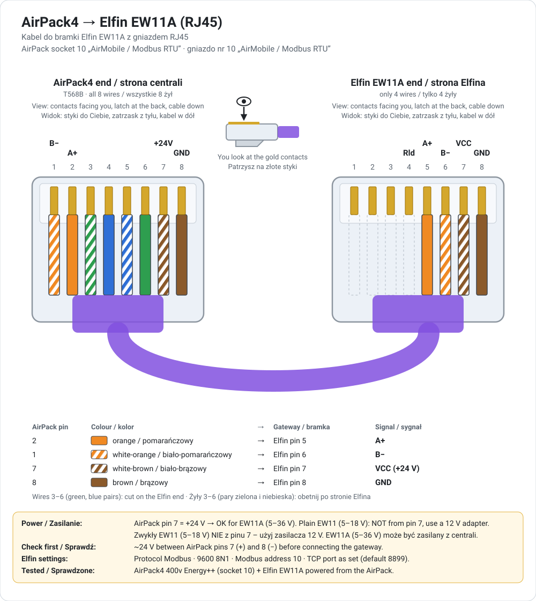
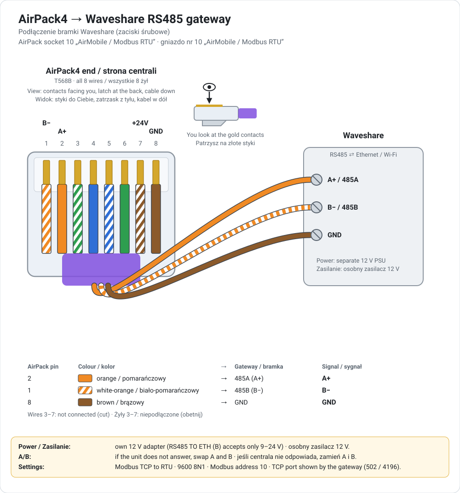

# Thessla Green AirPack4 for Home Assistant

**[English](#english) · [Polski](#polski)**

An unofficial Home Assistant integration for **Thessla Green AirPack4** heat-recovery ventilation units. It talks Modbus through a TCP → RTU gateway (Elfin EW11/EW10, Waveshare, USR, …).

---

<a id="english"></a>

## English

### Features

- **Control:** airflow, operating mode (Automatic / Manual / Temporary), season, special functions (fireplace, airing, open windows, empty house, hood), ECO / COMFORT (with duct exchangers), power, bypass and GWC.
- **Settings:** the user and installer settings from the Air++ menu: special-function intensities and durations, bypass and GWC parameters, AirS gears, per-mode airflow and supply temperature.
- **Two-way sync:** changes made on the Air++ panel, AirS or AirMobile appear in Home Assistant on the next poll.
- **Never breaks on other models:** the integration probes which registers your unit has.
  - Missing registers are skipped.
  - Sensors that aren't fitted are hidden.
  - A value the unit can't read right now shows *Unknown* instead of an error.
- **Live flow diagram:** shown in an **AirPack4** sidebar panel and as a dashboard card, similar to the Air++ unit screen. It shows temperatures, airflow, fans, filters, FPX, GWC, the duct heater and the bypass.
- **Heat recovery:** exchanger efficiency, recovered heat power and energy statistics (today, this month, this year, last 24 h / 30 days / 12 months, total).
- **Diagnostics:** alarms with descriptions, filter wear and replacement dates, a read-only mode, and diagnostics download.
- **Languages:** English and Polish.

### Supported devices

All AirPack4 variants covered by the manufacturer's `MODBUS_USER_AirPack_4` register map:

| | Enthalpy | Energy+ | Energy++ |
|---|---|---|---|
| **h** (horizontal) | 300 / 400 / 500 | 300 / 400 / 500 | 300 / 400 / 500 |
| **v** (vertical) | 300 / 400 / 500 | 300 / 400 / 500 / 550 | 300 / 400 / 500 / 550 |

- Tested on an **AirPack4 400v Energy++**, firmware **4.87.2**.
- Optional hardware is detected automatically: GWC, duct heater/cooler, constant flow (CF), ERV post-heater, and the Expansion module.

**Requirements:**
- Home Assistant **2025.10** or newer. The integration icon needs **2026.3** or newer.
- A Modbus TCP → RTU gateway on the same network as Home Assistant.

### 1. Connect the gateway

1. Connect the gateway to the AirPack's RJ45 **socket no. 10, "AirMobile / Modbus RTU"**, which is the Air-B Modbus port. The Air++ panel uses socket 11, so the two don't interfere. See [Cable](#cable) below.
2. Configure the gateway's serial side as **9600 baud, 8 data bits, no parity, 1 stop bit (8N1)**.
3. Set the gateway protocol to **Modbus TCP ↔ RTU conversion**.
   - **Elfin EW11 / EW10:** open the web page (default user/password `admin`/`admin`) → *Communication Settings* → *Protocol*: **Modbus**. Note the **Local Port**. The Elfin default is **8899**; many other gateways use **502**.
   - **Waveshare:** use the *Modbus TCP to RTU* mode.
   - Transparent / raw TCP mode is **not** supported.
4. Give the gateway a fixed IP address, for example with a DHCP reservation in your router.
5. The AirPack's Modbus device address is **10** by default (allowed range 10–19).

<a id="cable"></a>

#### Cable

The AirPack end is a standard RJ45 plug crimped to **T568B**. Pinout of socket 10:

| Pin | Colour | Signal |
|---|---|---|
| 1 | white-orange | RS-485 **B−** |
| 2 | orange | RS-485 **A+** |
| 3–6 | | not used |
| 7 | white-brown | **+24 V DC** |
| 8 | brown | **GND** |

Thessla Green does not publish this pinout. It comes from several independent community sources and is confirmed by a working AirPack4 400v Energy++ installation.
- **Measure about 24 V between pins 7 (+) and 8 (−)** before connecting a gateway.
- Only power a gateway from pin 7 if it accepts 24 V. The **Elfin EW11A** (5–36 V) does; a plain **EW11** (5–18 V) does **not** and needs its own 12 V adapter.

**Elfin EW11A with an RJ45 socket.** The gateway end uses only 4 wires: orange → 5 (A+), white-orange → 6 (B−), white-brown → 7 (VCC), brown → 8 (GND). It is not a straight patch cable.



**Waveshare (screw terminals).** Orange → A (485A), white-orange → B (485B), brown → GND. Power the gateway from its own 12 V adapter.



### 2. Install

**Home Assistant 2026.11 and newer: Marketplace.** HACS is now built into Home Assistant as the *Marketplace*.
1. *Settings → Marketplace* → **⋮** (top right) → **Custom repositories**.
2. Repository: `https://github.com/BartoszJanowski/thessla-green-airpack`, type **Integration** → **Add**.
3. Search for **Thessla Green AirPack4** → **Download**.
4. Restart Home Assistant: *Settings → System → ⋮ → Restart*.

**Home Assistant 2026.10 and older: HACS.** The same steps, starting from **HACS → ⋮ → Custom repositories**.

If you upgrade Home Assistant to 2026.11, an installation made through HACS is taken over by the Marketplace automatically.

**Manual:** copy `custom_components/thessla_green_airpack` to `<config>/custom_components/`, then restart Home Assistant.

### 3. Add the device

*Settings → Devices & services → + Add integration → Thessla Green AirPack4*:

| Field | Value |
|---|---|
| Name | Anything, e.g. `Recuperator` |
| Gateway host / IP | The gateway's IP address, e.g. `192.168.1.50` |
| TCP port | The gateway's Modbus port: `8899` (Elfin default) or `502` |
| Modbus device address | `10`, unless changed on the unit |
| Model | Your AirPack4 variant. It only sets the device name; hardware is detected automatically |

The first setup takes a few seconds while the integration checks which registers your unit has.

To change the IP, port or address later: *Devices & services → Thessla Green AirPack4 → ⋮ → Reconfigure*.

### 4. Options

*Devices & services → Thessla Green AirPack4 → ⚙ / Configure*:

| Option | Default | What it does |
|---|---|---|
| **Polling interval** | 30 s | How often the unit is read (5–300 s). One read takes about 2 s over Wi-Fi. 10–15 s makes panel changes show up faster. Below 10 s gains little but loads the gateway and the HA database more. Reading never wears the unit. |
| **Request timeout** | 3 s | How long to wait for an answer. Increase it for an unreliable Wi-Fi gateway. |
| **Delay between requests** | 0 ms | Pause between Modbus requests. Set 50–100 ms if you see intermittent *Unavailable* states. |
| **Special functions available on the panel** | all | Functions offered in the *Special function* selector. Untick the ones your installer has not configured (often *Hood*), because this can't be detected over Modbus. Their settings are hidden too. |
| **Installed equipment** | detected | Optional equipment and accessories you have. Settings and sensors of unticked items are hidden. See the table below. |
| **Read-only mode** | off | Blocks **every** write to the unit: Home Assistant only reads, and attempts to change something show an error. Recommended for the first day. Turn it off when you want to control the unit from Home Assistant. |

The integration reloads automatically after you save the options.

What each item hides when it is unticked:

| Item | Hidden entities | Default |
|---|---|---|
| *Hood* (special function) | hood supply and exhaust intensity | ticked |
| *Fireplace* (special function) | fireplace airflow unbalance and duration | ticked |
| *Airing* (special function) | room airing intensity and duration, manual-mode airing start | ticked |
| *Open windows* (special function) | open windows exhaust intensity and its AUTO switch | ticked |
| *Empty house* (special function) | empty house intensity | ticked |
| **GWC** | GWC switch, regeneration, thresholds, times, state, temperature, relay | ticked when the GWC sensor (TZ3) is detected |
| **Duct heater / cooler (ECO / COMFORT)** | ECO / COMFORT, COMFORT state, COMFORT target temperature, duct supply temperature (TN2), manual and temporary supply temperature | ticked when the TN2 sensor is detected |
| **ERV system** | ERV heater mode, ERV post-heater | unticked: its registers answer even without the system |
| **AirS panel** | AirS gear 1–3 intensity, AirS inputs | unticked (accessory) |
| **Hygrostat** | bathroom airing intensity, humidity input | unticked (accessory) |
| **Air quality sensor** | air quality airing intensity, air quality input | unticked (accessory) |
| **Airing switch** | switch airing intensity, bell switch airing duration, on/off delays, switch input | unticked (accessory) |

- Hidden entities are disabled, not deleted. Ticking the item brings them back with their history.
- Entities you disabled yourself are never enabled by the integration.
- **Re-detect hardware** ticks GWC or duct exchangers when it finds their sensors.

### 5. Controls and operating modes

The **Ventilation** fan entity is the main control:

| Preset | Meaning |
|---|---|
| **Automatic** | The unit follows its weekly schedule. Schedules are edited on the Air++ panel. |
| **Manual** | Constant airflow. Uses the *Manual airflow* setting. |
| **Temporary** | A temporary override. |

Changing the **airflow %**:
- in **Automatic** starts a **Temporary** override, exactly like turning the knob on the Air++ panel,
- in **Manual** changes the manual airflow.

0 % is rejected. Use the **Power** switch to turn the unit off.

Other controls:
- **Power:** turns the unit on and off, like the panel's power button.
- **Season:** summer / winter. This selects the summer or winter schedule.
- **Special function:** none / fireplace / airing / open windows / empty house / hood. The *Active function* sensor also shows functions started by wall switches or sensors.
- **ECO / COMFORT:** COMFORT keeps the supply temperature using the duct heater / cooler. The manufacturer's Modbus documentation says COMFORT is not available without duct exchangers, so these entities are shown only when *Duct heater / cooler* is ticked in Options (ticked automatically when the TN2 sensor is detected).
- **ERV:** a separate system with a secondary heater and its own modes (1 – economical, 2 – comfort), set on the Air++ panel under *Settings → ERV*. Its registers answer even on units without it, so tick *ERV system* in Options only if your Air++ panel has the ERV tab.

Under **Configuration** (device page):
- per-mode airflow and supply temperature. The *Temporary* ones are hidden by default because the Ventilation entity handles them. Supply temperatures are kept only in COMFORT, so they are shown only with duct exchangers.
- bypass and GWC on/off and their parameters,
- special-function intensities and durations. *Open windows exhaust intensity* can be **AUTO** (as on the Air++ panel): the intensity then comes from the active Automatic / Manual mode and the number shows *Unknown*. Use the *… from operating mode (AUTO)* switch to turn AUTO on; setting a number turns it off.
- AirS gears and accessory settings (when ticked in Options),
- filter replacement buttons: press after replacing a filter (units without AFC).

Under **Diagnostics:** firmware, inputs and outputs, control voltages, and **Re-detect hardware**. Press that after fitting new hardware, such as a GWC: new entities appear, and newly detected GWC or duct exchangers are ticked in Options.

Entity order on the device page is alphabetical. That is how Home Assistant works, and an integration can't change it.

### 6. Flow diagram

- **Sidebar panel:** **AirPack4** in the sidebar shows the live diagram full-page. It's also opened by the **Visit** button on the device page.
  - To hide it from the sidebar, long-press the sidebar title and hide *AirPack4*.
- **Dashboard card:** edit a dashboard → **+ Add card** → search **Thessla**. Or add a *Manual* card:

  ```yaml
  type: custom:thessla-airpack-card
  # device_id: optional – defaults to the first AirPack
  # title: optional
  ```

What the diagram shows:
- Each air path with temperature, fan intensity, airflow and filter wear.
- When the **bypass** opens, the exchanger fades and shows *BYPASS*, and supply air is drawn along the bypass path.
- Under the exchanger: the heat recovery power now and the energy recovered today.
- FPX, GWC and the duct heater appear only if your unit has them.
- Tapping an element opens its entity.

#### Heat recovery

**Heat recovery – power** is the heat the exchanger passes to the fresh air:

> P [W] = supply airflow [m³/h] × 0.335 × (supply temperature TN1 − intake temperature TZ1)

- Only heating counts. An open bypass, a stopped unit, or supply air no warmer than outside air gives 0 W.
- Airflow is the measured value (Constant Flow). Units without it use the target airflow.
- It is calculated from the unit's own sensors (about ±0.5 °C), so treat it as a good approximation, not a heat meter. Heat from the supply fan motor raises the result by a few tens of watts.

The **Heat recovery – …** energy sensors (kWh) add it up every poll:

| Sensor | Period |
|---|---|
| total | since the integration was installed, never decreases |
| today / this month / this year | calendar periods, reset at midnight, on the 1st, on 1 January |
| last 24 h / last 30 days / last 12 months | rolling windows: the current hour, day or month plus the previous 23 hours, 29 days or 11 months |

- Statistics are saved and survive restarts.
- Time when Home Assistant was not running, or the unit did not respond for over 10 minutes, is not counted.
- For bar charts by day, week or month, add a **Statistics graph** card with *Heat recovery – total* and choose the period and *Change*.

### 7. Updating

New versions are published as [GitHub releases](https://github.com/BartoszJanowski/thessla-green-airpack/releases). Home Assistant shows them as an update, with the release notes.
- *Settings → Updates*, or *Marketplace / HACS → Thessla Green AirPack4*, → **Update**.
- To check for a new version right away: **⋮ → Update information**.
- Restart Home Assistant, then hard-refresh the browser (Ctrl+F5 / Cmd+Shift+R).

### 8. Troubleshooting

- **"Cannot connect to the gateway":** check the IP address and port, and that the gateway is reachable from Home Assistant.
- **"The gateway is reachable but the AirPack does not answer":**
  - Check the device address (10).
  - Check A/B wiring (try swapping A and B).
  - Check the gateway serial settings (9600 8N1).
  - Make sure the gateway is in Modbus TCP→RTU mode.
- **Entities briefly become *Unavailable*:** increase *Delay between requests* and *Request timeout*. Don't connect two Modbus clients to the same gateway at once (for example an old integration and this one).
- **Entity names are in English although the interface is in Polish:** entity names follow the *system* language (*Settings → System → General → Language*), not your profile language. Set it to Polski and restart.
- **The card can't be found:** hard-refresh the browser. In the mobile app, pull down to reload.
- **A setting or control is missing (e.g. ECO / COMFORT, AirS gears, hood settings):** tick the equipment or special function in *Options*. See [Options](#4-options).
- **The panel in the mobile app shows an old version after an update:** in the app go to *Settings → Companion app → Debugging → Reset frontend cache*, or close the app completely and open it again.
- **Which registers does my unit have?**
  - Device page → **⋮ → Download diagnostics**.
  - Or run the read-only probe. It can only send Modbus *read* requests:

    ```bash
    pip install pymodbus
    python -I tools/probe.py --host 192.168.1.50 --port 8899 --unit 10 --json probe-out.json
    ```

### 9. Reporting problems

Please open an [issue](https://github.com/BartoszJanowski/thessla-green-airpack/issues/new/choose). Include:
- your model and firmware,
- the Home Assistant and integration versions,
- the **diagnostics** file (it does not contain your IP address or serial number).

Pull requests are not accepted; please describe the change in an issue instead.

### Development

```bash
python3 -m venv .venv && .venv/bin/pip install -r requirements_test.txt
.venv/bin/python -m pytest
```

- `tools/card_preview.html`: the card with mocked data. Add `?lang=pl` for Polish and `?w=360` for phone width.
- `tools/gen_translations.py`: regenerates `strings.json` and `translations/{en,pl}.json`.
- `assets/icon.svg`: source of the icon in `brand/`. It's an original design, not the manufacturer's logo.

---

<a id="polski"></a>

## Polski

### Możliwości

- **Sterowanie:** intensywność, tryb pracy (automatyczny / manualny / chwilowy), sezon, funkcje specjalne (kominek, wietrzenie, otwarte okna, pusty dom, okap), EKO / KOMFORT (z wymiennikami kanałowymi), zasilanie, bypass i GWC.
- **Ustawienia:** nastawy użytkownika i instalatora z menu Air++: intensywności i czasy funkcji specjalnych, parametry bypassu i GWC, biegi AirS, intensywność i temperatura nawiewu dla trybów.
- **Synchronizacja w obie strony:** zmiany z panelu Air++, AirS lub AirMobile pojawiają się w Home Assistancie przy następnym odczycie.
- **Nie psuje się na innych modelach:** integracja sprawdza, które rejestry ma Twoja centrala.
  - Brakujące rejestry są pomijane.
  - Niezamontowane czujniki są ukrywane.
  - Chwilowo nieodczytana wartość pokazuje się jako *Nieznany* zamiast błędu.
- **Schemat pracy na żywo:** w panelu **AirPack4** w menu bocznym i jako karta na pulpit, podobny do ekranu Air++. Pokazuje temperatury, przepływy, wentylatory, filtry, FPX, GWC, nagrzewnicę i bypass.
- **Odzysk ciepła:** sprawność wymiennika, moc odzysku i statystyki odzyskanej energii (dzisiaj, ten miesiąc, ten rok, ostatnie 24 h / 30 dni / 12 miesięcy, całkowity).
- **Diagnostyka:** alarmy z opisami, zużycie i terminy wymiany filtrów, tryb tylko do odczytu i pobieranie diagnostyki.
- **Języki:** polski i angielski.

### Obsługiwane urządzenia

Wszystkie odmiany AirPack4 z mapy rejestrów producenta `MODBUS_USER_AirPack_4`:

| | Enthalpy | Energy+ | Energy++ |
|---|---|---|---|
| **h** (poziome) | 300 / 400 / 500 | 300 / 400 / 500 | 300 / 400 / 500 |
| **v** (pionowe) | 300 / 400 / 500 | 300 / 400 / 500 / 550 | 300 / 400 / 500 / 550 |

- Przetestowane na **AirPack4 400v Energy++**, oprogramowanie **4.87.2**.
- Wyposażenie dodatkowe wykrywane jest automatycznie: GWC, nagrzewnica/chłodnica kanałowa, Constant Flow (CF), nagrzewnica wtórna ERV i moduł Expansion.

**Wymagania:**
- Home Assistant **2025.10** lub nowszy. Ikona integracji wymaga wersji **2026.3** lub nowszej.
- Bramka Modbus TCP → RTU w tej samej sieci co Home Assistant.

### 1. Podłączenie bramki

1. Podłącz bramkę do gniazda RJ45 centrali **nr 10 „AirMobile / Modbus RTU”**, czyli portu Modbus Air-B. Panel Air++ korzysta z gniazda 11, więc sobie nie przeszkadzają. Zobacz [Kabel](#kabel) poniżej.
2. Ustaw port szeregowy bramki: **9600 bodów, 8 bitów danych, bez parzystości, 1 bit stopu (8N1)**.
3. Ustaw w bramce tryb **konwersji Modbus TCP ↔ RTU**.
   - **Elfin EW11 / EW10:** otwórz stronę bramki (domyślnie login/hasło `admin`/`admin`) → *Communication Settings* → *Protocol*: **Modbus**. Zanotuj **Local Port**. Domyślny port Elfina to **8899**, wiele innych bramek używa **502**.
   - **Waveshare:** wybierz tryb *Modbus TCP to RTU*.
   - Tryb transparentny („raw TCP”) **nie** jest obsługiwany.
4. Nadaj bramce stały adres IP, np. przez rezerwację DHCP w routerze.
5. Adres Modbus centrali to domyślnie **10** (dozwolony zakres 10–19).

<a id="kabel"></a>

#### Kabel

Po stronie centrali jest zwykła wtyczka RJ45 zarobiona w standardzie **T568B**. Pinout gniazda nr 10:

| Pin | Kolor | Sygnał |
|---|---|---|
| 1 | biało-pomarańczowy | RS-485 **B−** |
| 2 | pomarańczowy | RS-485 **A+** |
| 3–6 | | nieużywane |
| 7 | biało-brązowy | **+24 V DC** |
| 8 | brązowy | **GND** |

Thessla Green nie publikuje tego pinoutu. Pochodzi z kilku niezależnych źródeł społeczności i jest potwierdzony działającą instalacją AirPack4 400v Energy++.
- **Zmierz ok. 24 V między pinami 7 (+) i 8 (−)** przed podłączeniem bramki.
- Zasilaj bramkę z pinu 7 tylko wtedy, gdy przyjmuje 24 V. **Elfin EW11A** (5–36 V) przyjmuje, a zwykły **EW11** (5–18 V) **nie** i potrzebuje własnego zasilacza 12 V.

**Elfin EW11A z gniazdem RJ45.** Po stronie bramki są tylko 4 żyły: pomarańczowy → 5 (A+), biało-pomarańczowy → 6 (B−), biało-brązowy → 7 (VCC), brązowy → 8 (GND). To nie jest zwykły kabel prosty.


**Waveshare (zaciski śrubowe).** Pomarańczowy → A (485A), biało-pomarańczowy → B (485B), brązowy → GND. Zasilaj bramkę jej własnym zasilaczem 12 V.


### 2. Instalacja

**Home Assistant 2026.11 i nowszy: Marketplace.** HACS jest teraz wbudowany w Home Assistanta jako *Marketplace*.
1. *Ustawienia → Marketplace* → **⋮** (prawy górny róg) → **Niestandardowe repozytoria** (Custom repositories).
2. Repozytorium: `https://github.com/BartoszJanowski/thessla-green-airpack`, typ **Integracja** → **Dodaj**.
3. Wyszukaj **Thessla Green AirPack4** → **Pobierz**.
4. Uruchom ponownie Home Assistanta: *Ustawienia → System → ⋮ → Uruchom ponownie*.

**Home Assistant 2026.10 i starszy: HACS.** Te same kroki, zaczynając od **HACS → ⋮ → Niestandardowe repozytoria**.

Po aktualizacji Home Assistanta do 2026.11 instalację z HACS automatycznie przejmuje Marketplace.

**Ręcznie:** skopiuj `custom_components/thessla_green_airpack` do `<config>/custom_components/`, potem uruchom ponownie Home Assistanta.

### 3. Dodanie centrali

*Ustawienia → Urządzenia oraz usługi → + Dodaj integrację → Thessla Green AirPack4*:

| Pole | Wartość |
|---|---|
| Nazwa | Dowolna, np. `Rekuperator` |
| Adres bramki / IP | Adres IP bramki, np. `192.168.1.50` |
| Port TCP | Port Modbus bramki: `8899` (domyślny w Elfinie) lub `502` |
| Adres urządzenia Modbus | `10`, chyba że zmieniono go w centrali |
| Model | Twoja odmiana AirPack4. Wpływa tylko na nazwę urządzenia, sprzęt jest wykrywany automatycznie |

Pierwsza konfiguracja trwa kilka sekund, bo integracja sprawdza, które rejestry ma Twoja centrala.

Zmiana IP, portu lub adresu później: *Urządzenia oraz usługi → Thessla Green AirPack4 → ⋮ → Skonfiguruj ponownie*.

### 4. Opcje

*Urządzenia oraz usługi → Thessla Green AirPack4 → ⚙ / Konfiguruj*:

| Opcja | Domyślnie | Działanie |
|---|---|---|
| **Interwał odpytywania** | 30 s | Jak często odczytywana jest centrala (5–300 s). Jeden odczyt przez Wi‑Fi trwa ok. 2 s. Przy 10–15 s zmiany z panelu pojawiają się szybciej. Poniżej 10 s zysk jest niewielki, a bramka i baza HA są bardziej obciążone. Odczyt nie zużywa centrali. |
| **Limit czasu zapytania** | 3 s | Jak długo czekać na odpowiedź. Zwiększ przy niestabilnej bramce Wi‑Fi. |
| **Opóźnienie między zapytaniami** | 0 ms | Przerwa między zapytaniami Modbus. Ustaw 50–100 ms, jeśli encje chwilami robią się *Niedostępne*. |
| **Funkcje specjalne dostępne na panelu** | wszystkie | Funkcje w wyborze *Funkcja specjalna*. Odznacz te, których instalator nie skonfigurował (często *Okap*), bo tego nie da się wykryć przez Modbus. Ich ustawienia też są wtedy ukryte. |
| **Wyposażenie centrali** | wykryte | Wyposażenie dodatkowe i akcesoria, które masz. Ustawienia i czujniki odznaczonych pozycji są ukryte. Szczegóły w tabeli poniżej. |
| **Tryb tylko do odczytu** | wyłączony | Blokuje **każdy** zapis do centrali: Home Assistant tylko czyta, a próba zmiany kończy się komunikatem błędu. Zalecany na pierwszy dzień. Wyłącz, gdy chcesz sterować centralą z Home Assistanta. |

Po zapisaniu opcji integracja sama się przeładowuje.

Co ukrywa każda odznaczona pozycja:

| Pozycja | Ukryte encje | Domyślnie |
|---|---|---|
| *Okap* (funkcja specjalna) | OKAP – intensywność nawiewu i wywiewu | zaznaczona |
| *Kominek* (funkcja specjalna) | KOMINEK – różnicowanie strumieni i czas | zaznaczona |
| *Wietrzenie* (funkcja specjalna) | WIETRZENIE (pokoje) – intensywność i czas, start wietrzenia w trybie manualnym | zaznaczona |
| *Otwarte okna* (funkcja specjalna) | OTWARTE OKNA – intensywność wywiewu i jej przełącznik AUTO | zaznaczona |
| *Pusty dom* (funkcja specjalna) | PUSTY DOM – intensywność | zaznaczona |
| **GWC** | GWC aktywny, regeneracja, progi, godziny, stan, temperatura, przekaźnik | zaznaczona, gdy wykryto czujnik GWC (TZ3) |
| **Wymienniki kanałowe (EKO / KOMFORT)** | EKO / KOMFORT, stan trybu KOMFORT, temperatura zadana KOMFORT, temperatura za nagrzewnicą kanałową (TN2), temperatura nawiewu w trybie manualnym i chwilowym | zaznaczona, gdy wykryto czujnik TN2 |
| **System ERV** | tryb nagrzewnicy ERV, nagrzewnica wtórna ERV | odznaczona: rejestry ERV odpowiadają także bez systemu |
| **Panel AirS** | AirS – intensywność biegów 1–3, wejścia AirS | odznaczona (akcesorium) |
| **Higrostat** | WIETRZENIE (łazienka) – intensywność, wejście czujnika wilgotności | odznaczona (akcesorium) |
| **Czujnik jakości powietrza** | WIETRZENIE (jakość powietrza) – intensywność, wejście czujnika | odznaczona (akcesorium) |
| **Przełącznik wietrzenia** | WIETRZENIE (przełącznik) – intensywność, WIETRZENIE (dzwonkowy) – czas, opóźnienia, wejście przełącznika | odznaczona (akcesorium) |

- Ukryte encje są wyłączone, a nie usunięte. Zaznaczenie pozycji przywraca je razem z historią.
- Encji, które wyłączyłeś sam, integracja nigdy nie włącza.
- **Wykryj ponownie sprzęt** zaznacza GWC lub wymienniki kanałowe, gdy znajdzie ich czujniki.

### 5. Sterowanie i tryby pracy

Główną kontrolką jest encja **Wentylacja**:

| Tryb | Znaczenie |
|---|---|
| **Automatyczny** | Centrala pracuje według harmonogramu tygodniowego. Harmonogram edytuje się na panelu Air++. |
| **Manualny** | Stała intensywność, z nastawy *Intensywność – tryb manualny*. |
| **Chwilowy** | Tymczasowa zmiana. |

Zmiana **intensywności %**:
- w trybie **automatycznym** włącza tryb **chwilowy**, dokładnie jak pokrętło na panelu Air++,
- w trybie **manualnym** zmienia intensywność manualną.

0 % jest odrzucane. Do wyłączenia centrali służy przełącznik **Zasilanie**.

Pozostałe kontrolki:
- **Zasilanie:** włącza i wyłącza centralę, jak przycisk na panelu.
- **Sezon:** lato / zima. Wybiera harmonogram letni lub zimowy.
- **Funkcja specjalna:** brak / kominek / wietrzenie / otwarte okna / pusty dom / okap. Czujnik *Aktywna funkcja* pokazuje też funkcje uruchomione przyciskami lub czujnikami podłączonymi do centrali.
- **EKO / KOMFORT:** KOMFORT utrzymuje temperaturę nawiewu nagrzewnicą / chłodnicą kanałową. Według dokumentacji Modbus producenta tryb KOMFORT jest niedostępny bez wymienników kanałowych, dlatego te encje są widoczne tylko wtedy, gdy w Opcjach zaznaczono *Wymienniki kanałowe* (zaznaczane automatycznie po wykryciu czujnika TN2).
- **ERV:** osobny system z nagrzewnicą wtórną i własnymi trybami (1 – ekonomiczny, 2 – komfortowy), ustawiany w Air++ w *Ustawienia → Nastawy → ERV*. Rejestry ERV odpowiadają także w centralach bez tego systemu, więc zaznacz *System ERV* w Opcjach tylko wtedy, gdy Twój panel Air++ ma zakładkę ERV.

W sekcji **Konfiguracja** (strona urządzenia):
- intensywność i temperatura nawiewu dla trybów. Nastawy trybu *chwilowego* są domyślnie ukryte, bo obsługuje je encja Wentylacja. Temperatura nawiewu jest utrzymywana tylko w trybie KOMFORT, więc widać ją tylko przy wymiennikach kanałowych.
- włączanie bypassu i GWC oraz ich parametry,
- intensywności i czasy funkcji specjalnych. *OTWARTE OKNA – intensywność wywiewu* może mieć wartość **AUTO** (jak w Air++): intensywność jest wtedy brana z aktywnego trybu automatycznego / manualnego, a pole liczbowe pokazuje *Nieznany*. AUTO włącza przełącznik *… z trybu pracy (AUTO)*; ustawienie liczby je wyłącza.
- biegi AirS i ustawienia akcesoriów (gdy są zaznaczone w Opcjach),
- przyciski wymiany filtrów: naciśnij po wymianie filtra (centrale bez AFC).

W sekcji **Diagnostyka:** oprogramowanie, wejścia i wyjścia, napięcia sterujące oraz **Wykryj ponownie sprzęt**. Użyj go po zamontowaniu nowego sprzętu, np. GWC: pojawią się nowe encje, a nowo wykryte GWC lub wymienniki kanałowe zostaną zaznaczone w Opcjach.

Kolejność encji na stronie urządzenia jest alfabetyczna. Tak działa Home Assistant, a integracja nie może jej zmienić.

### 6. Schemat pracy

- **Panel w menu bocznym:** **AirPack4** pokazuje schemat na żywo na całym ekranie. Otwiera go też przycisk **Odwiedź** na stronie urządzenia.
  - Żeby ukryć go w menu, przytrzymaj tytuł menu bocznego i ukryj *AirPack4*.
- **Karta na pulpit:** edytuj pulpit → **+ Dodaj kartę** → wyszukaj **Thessla**. Możesz też dodać kartę *Ręczna*:

  ```yaml
  type: custom:thessla-airpack-card
  # device_id: opcjonalnie – domyślnie pierwsza centrala
  # title: opcjonalnie
  ```

Co pokazuje schemat:
- Każdą ścieżkę powietrza z temperaturą, intensywnością wentylatora, przepływem i zużyciem filtra.
- Gdy otworzy się **bypass**, wymiennik przygasa i pokazuje *BYPASS*, a nawiew płynie linią bypassu.
- Pod wymiennikiem: moc odzysku ciepła teraz i energię odzyskaną dzisiaj.
- FPX, GWC i nagrzewnica pojawiają się tylko wtedy, gdy centrala je ma.
- Kliknięcie elementu otwiera jego encję.

#### Odzysk ciepła

**Odzysk ciepła – moc** to ciepło, które wymiennik przekazuje świeżemu powietrzu:

> P [W] = przepływ nawiewu [m³/h] × 0,335 × (temperatura nawiewu TN1 − temperatura czerpni TZ1)

- Liczone jest tylko grzanie. Otwarty bypass, wyłączona centrala albo nawiew nie cieplejszy niż powietrze zewnętrzne dają 0 W.
- Przepływ to wartość zmierzona (Constant Flow). Centrale bez niej używają przepływu zadanego.
- Wynik pochodzi z czujników centrali (ok. ±0,5 °C), więc to dobre przybliżenie, a nie ciepłomierz. Ciepło silnika wentylatora nawiewnego zawyża wynik o kilkadziesiąt watów.

Czujniki energii **Odzysk ciepła – …** (kWh) sumują ją przy każdym odczycie:

| Czujnik | Okres |
|---|---|
| całkowity | od instalacji integracji, nigdy nie maleje |
| dzisiaj / ten miesiąc / ten rok | okresy kalendarzowe, zerowane o północy, 1. dnia miesiąca i 1 stycznia |
| ostatnie 24 h / 30 dni / 12 miesięcy | okna kroczące: bieżąca godzina, dzień lub miesiąc plus poprzednie 23 godziny, 29 dni lub 11 miesięcy |

- Statystyki są zapisywane i przetrwają restart.
- Czas, gdy Home Assistant nie działał albo centrala nie odpowiadała dłużej niż 10 minut, nie jest liczony.
- Wykres słupkowy dzienny, tygodniowy lub miesięczny: dodaj kartę **Wykres statystyk** z encją *Odzysk ciepła – całkowity*, wybierz okres i *Zmiana*.

### 7. Aktualizacja

Nowe wersje są publikowane jako [wydania na GitHubie](https://github.com/BartoszJanowski/thessla-green-airpack/releases). Home Assistant pokazuje je jako aktualizację, razem z listą zmian.
- *Ustawienia → Aktualizacje* albo *Marketplace / HACS → Thessla Green AirPack4* → **Aktualizuj**.
- Żeby od razu sprawdzić nową wersję: **⋮ → Aktualizuj informacje**.
- Uruchom ponownie Home Assistanta, potem zrób twarde odświeżenie przeglądarki (Ctrl+F5 / Cmd+Shift+R).

### 8. Rozwiązywanie problemów

- **„Nie można połączyć się z bramką”:** sprawdź adres IP i port oraz to, czy bramka jest osiągalna z Home Assistanta.
- **„Bramka odpowiada, ale centrala nie”:**
  - Sprawdź adres urządzenia (10).
  - Sprawdź okablowanie A/B (spróbuj zamienić A i B).
  - Sprawdź ustawienia portu szeregowego bramki (9600 8N1).
  - Upewnij się, że bramka jest w trybie Modbus TCP→RTU.
- **Encje chwilami są *Niedostępne*:** zwiększ *Opóźnienie między zapytaniami* i *Limit czasu zapytania*. Nie podłączaj dwóch klientów Modbus do jednej bramki naraz (np. starej integracji i tej).
- **Nazwy encji są po angielsku, choć interfejs jest po polsku:** nazwy encji zależą od języka *systemu* (*Ustawienia → System → Ogólne → Język*), a nie języka profilu. Ustaw Polski i uruchom HA ponownie.
- **Karty nie ma na liście:** zrób twarde odświeżenie przeglądarki. W aplikacji mobilnej przeciągnij ekran w dół.
- **Brakuje ustawienia lub sterowania (np. EKO / KOMFORT, biegów AirS, ustawień okapu):** zaznacz wyposażenie lub funkcję specjalną w *Opcjach*. Zobacz [Opcje](#4-opcje).
- **Panel w aplikacji mobilnej po aktualizacji pokazuje starą wersję:** w aplikacji wejdź w *Ustawienia → Aplikacja towarzysząca → Debugowanie → Zresetuj pamięć podręczną interfejsu* albo zamknij aplikację całkowicie i otwórz ponownie.
- **Które rejestry ma moja centrala?**
  - Strona urządzenia → **⋮ → Pobierz diagnostykę**.
  - Albo uruchom sondę tylko do odczytu. Może wysyłać wyłącznie zapytania *odczytu* Modbus:

    ```bash
    pip install pymodbus
    python -I tools/probe.py --host 192.168.1.50 --port 8899 --unit 10 --json probe-out.json
    ```

### 9. Zgłaszanie problemów

Załóż [zgłoszenie (issue)](https://github.com/BartoszJanowski/thessla-green-airpack/issues/new/choose). Podaj:
- model i wersję oprogramowania centrali,
- wersje Home Assistanta i integracji,
- plik **diagnostyki** (nie zawiera adresu IP ani numeru seryjnego).

Pull requesty nie są przyjmowane. Opisz proponowaną zmianę w zgłoszeniu.

---

## Disclaimer / Zastrzeżenie

This is an unofficial project, not affiliated with Thessla Green. Changing ventilation settings is at your own risk. Licensed under the MIT License.

Projekt nieoficjalny, niezwiązany z Thessla Green. Zmiany ustawień wentylacji wykonujesz na własną odpowiedzialność. Licencja MIT.
